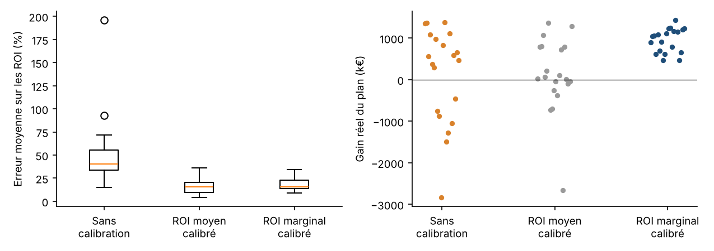

# Marketing Mix Modeling : prédire juste ne suffit pas

Un modèle de marketing mix (MMM) open source, avec adstock, saturation, optimisation du budget et
calibration par tests terrain. Il est **validé sur des données simulées dont on connaît la vérité** :
on peut donc vérifier non seulement s'il prédit bien les ventes, mais s'il attribue les ventes aux
bons canaux, et si ses recommandations de budget font vraiment gagner de l'argent.

> Projet personnel inspiré de mon expérience en MMM. Aucune donnée client : tout est simulé.

## Le résultat principal : 20 marchés simulés

On simule 20 marchés différents (dépenses, promotions, bruit) dont on **connaît la vérité**, on
construit le modèle sans la regarder, puis on vérifie si le plan de budget recommandé fait vraiment
gagner des ventes. Trois versions du modèle (rapport complet : [`reports/robustness.md`](reports/robustness.md)) :

| Médiane sur 20 marchés | Sans calibration | Calibré sur le ROI moyen (tests d'arrêt) | **Calibré sur le ROI marginal (tests ±30 %)** |
|---|---|---|---|
| Erreur de prédiction (26 semaines non vues) | 1,4 % | 2,0 % | 2,0 % |
| Erreur moyenne sur les ROI | 40 % | 16 % | 16 % |
| Marchés où le plan **fait perdre** des ventes | 7 / 20 | 8 / 20 | **0 / 20** |
| Gain réel du plan | 519 k€ | 45 k€ | **1 051 k€** |
| Part du meilleur gain possible obtenue | 35 % | 3 % | **70 %** |



**Ce que ça montre, en trois étapes**
1. **Prédire juste ne suffit pas.** Le modèle prédit les ventes à 1,4 % près mais se trompe de 40 %
   sur les ROI, et son plan fait perdre des ventes sur 7 marchés sur 20.
2. **Corriger le ROI moyen ne suffit pas non plus.** Les tests classiques (couper un canal dans des
   régions tests) ramènent l'erreur sur les ROI à 16 %, mais les plans restent mauvais : une
   réallocation dépend du **ROI marginal** (ce que rapportent les euros qu'on déplace), donc de la
   forme de la saturation, que ces tests ne mesurent pas.
3. **Tester ce que la décision va changer.** Des tests où l'on augmente ou baisse la dépense de 30 %
   mesurent ce ROI marginal : plus aucun plan perdant, et 70 % du meilleur gain possible.

**Conseil au client** : concevoir les tests en fonction de la décision à prendre, et limiter les
réallocations à la zone testée (ici ±30 %).

### Un marché en détail
`python scripts/run_experiment.py` détaille un marché (graine 7, tests d'arrêt sur 3 canaux) : courbes
de réponse, intervalles de confiance par bootstrap, stabilité, demi-vies retrouvées
([`reports/report.md`](reports/report.md)). C'est un cas extrême : le modèle non calibré y prédit à
1,7 % près avec 91 % d'erreur sur les ROI.

## Comment ça marche
**Données** (`simulate.py`) : 156 semaines, 5 canaux (TV, Meta, YouTube, Search, affichage), avec des
campagnes par vagues, des dépenses digitales continues, saisonnalité, tendance, prix, promotions,
bruit. Chaque canal a une vraie rémanence, une vraie saturation et un vrai ROI.

**Transformations** (`transforms.py`)
- Adstock (rémanence) : $A_t = x_t + \lambda A_{t-1}$ ; demi-vie $= \ln 0{,}5 / \ln \lambda$.
- Saturation de Hill : $h(a) = a^s / (K^s + a^s)$, rendements décroissants.

**Modèle** (`model.py`) : ventes = constante + tendance + saisonnalité (termes de Fourier) + prix +
promotions + Σ β·h(adstock(dépense)). Coefficients média contraints à être positifs, légère
régularisation ridge contre la colinéarité. Les paramètres d'adstock et de saturation sont choisis
par recherche aléatoire puis affinage, en minimisant l'erreur sur les 26 dernières semaines, que le
modèle ne voit pas pendant l'estimation.

**Analyse** (`analysis.py`)
- Contribution d'un canal = ventes prédites − ventes prédites sans ce canal ; ROI = contribution / dépense.
- ROI marginal : ce que rapporterait le prochain euro (+1 % de dépense).
- Courbes de réponse, intervalle de confiance par bootstrap par blocs de semaines, stabilité
  (réestimation sans le début ou la fin de la période).
- Optimisation du budget : même budget total, chaque canal modifié d'au plus ±30 %, maximisation des
  ventes prédites (SLSQP).

**Calibration** (`calibration.py`) : deux types de tests terrain, mesurés avec une erreur de 15 %.
- Test d'arrêt : ROI moyen du canal.
- Test ±30 % : ventes supplémentaires par euro supplémentaire (ou perdues par euro retiré), le ROI marginal.
La recherche des paramètres est pénalisée quand le modèle s'écarte des mesures (en nombre d'écarts-types).

## Lancer
```bash
pip install -r requirements.txt
pytest -q                             # 8 tests
python scripts/run_robustness.py      # 20 marchés, environ 20 minutes ; --seeds 5 --fast pour un aperçu
python scripts/run_experiment.py      # un marché en détail, environ 15 secondes
python scripts/run_experiment.py --tested tv,meta,search,youtube,ooh   # tester tous les canaux
python scripts/run_experiment.py --max-change 0.15                    # réallocation plus prudente
```

## Tests
Adstock, saturation, demi-vie ; cohérence de la vérité simulée ; coefficients média positifs ;
récupération des ROI avec les vraies transformations ; **la calibration réduit l'erreur sur les ROI** ; les tests ±30 % mesurent le ROI marginal ;
l'optimiseur respecte le budget et les bornes ; bootstrap et stabilité.

## Limites et suite
- Les 20 marchés partagent les mêmes vrais effets ; d'autres structures (synergies entre canaux,
  effets qui changent dans le temps) restent à tester.
- Approche fréquentiste avec recherche aléatoire ; une version bayésienne (PyMC-Marketing, Meridian)
  permettrait d'intégrer les tests terrain comme des a priori et de propager l'incertitude.
- Optimisation robuste : choisir le plan qui reste bon sur l'ensemble des modèles plausibles
  (bootstrap), et non sur un seul.
- Effets croisés entre marques (cannibalisation) non modélisés.

## Structure
```
src/mmm/simulate.py     données avec vérité connue, ventes réelles d'un plan
src/mmm/transforms.py   adstock, saturation de Hill, demi-vie
src/mmm/model.py        modèle, contraintes, recherche des paramètres, validation hors échantillon
src/mmm/analysis.py     contributions, ROI, ROI marginal, bootstrap, stabilité, optimisation
src/mmm/calibration.py  tests d'arrêt (ROI moyen), tests ±30 % (ROI marginal), pénalités
scripts/run_robustness.py  20 marchés, 3 versions du modèle -> reports/robustness.md
scripts/run_experiment.py  un marché en détail, rapport et graphiques
```
