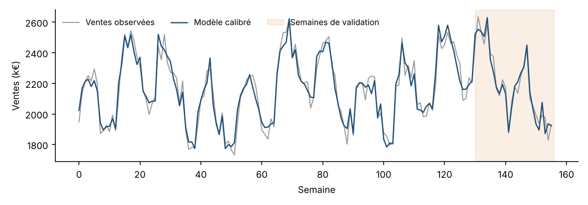
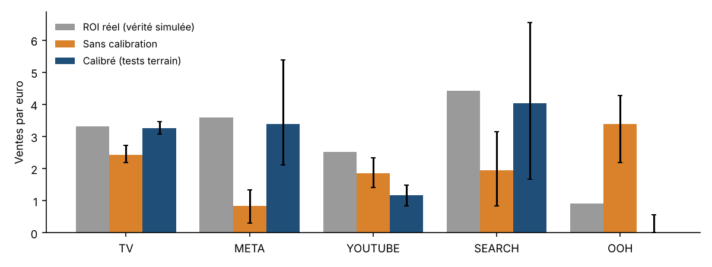
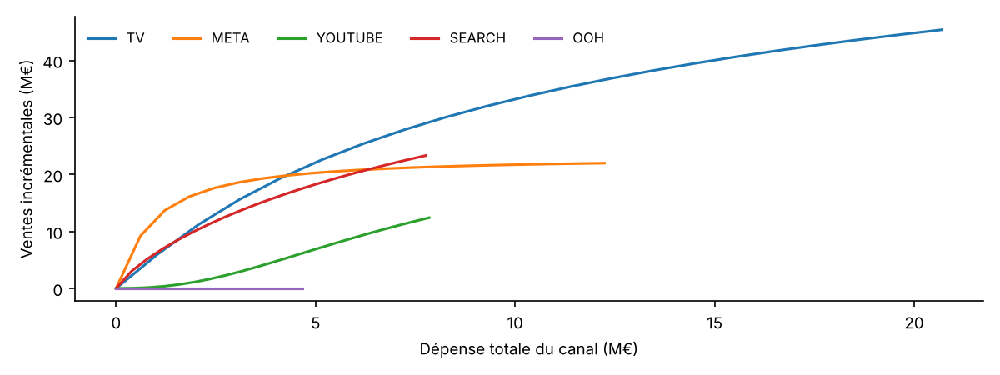
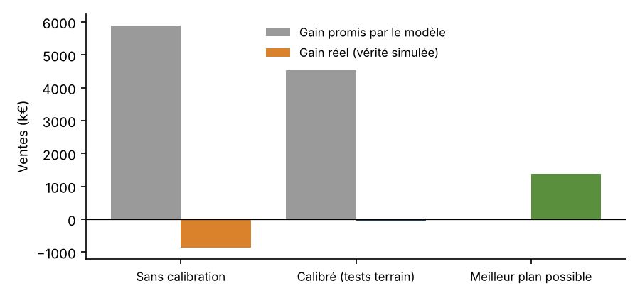

# Résultats de l'expérience

Données simulées : 156 semaines, 5 canaux. Tests terrain simulés sur : tv, meta, search (erreur de mesure 15 %). Réallocation limitée à ±30 % par canal.

## Qualité de prédiction et justesse des ROI

| Modèle | Erreur de prédiction (MAPE, 26 dernières semaines) | Erreur moyenne sur les ROI | Variation max. des ROI (stabilité) |
|---|---|---|---|
| Sans calibration | 1.7 % | 91 % | 8 % |
| Calibré (tests terrain) | 2.0 % | 34 % | 38 % |

## ROI par canal

| Canal | ROI réel | Sans calibration (IC 90 %) | Calibré (tests terrain) (IC 90 %) |
|---|---|---|---|
| TV | 3.31 | 2.43 [2.19 ; 2.73] | 3.26 [3.08 ; 3.46] |
| META | 3.59 | 0.84 [0.30 ; 1.35] | 3.40 [2.12 ; 5.38] |
| YOUTUBE | 2.52 | 1.86 [1.41 ; 2.33] | 1.17 [0.84 ; 1.48] |
| SEARCH | 4.42 | 1.94 [0.84 ; 3.14] | 4.04 [1.67 ; 6.55] |
| OOH | 0.92 | 3.39 [2.20 ; 4.27] | 0.00 [0.00 ; 0.56] |

## Rémanence (adstock) retrouvée par le modèle calibré

| Canal | λ réel | λ estimé | Demi-vie estimée (semaines) |
|---|---|---|---|
| TV | 0.65 | 0.54 | 1.1 |
| META | 0.30 | 0.65 | 1.6 |
| YOUTUBE | 0.45 | 0.47 | 0.9 |
| SEARCH | 0.05 | 0.07 | 0.3 |
| OOH | 0.55 | 0.23 | 0.5 |

## Réallocation du budget (budget constant)

| Modèle | Part du budget réallouée | Gain promis | Gain réel |
|---|---|---|---|
| Sans calibration | 13 % | 5 892 k€ | -872 k€ |
| Calibré (tests terrain) | 10 % | 4 534 k€ | -35 k€ |
| Meilleur plan possible (connaissant la vérité) | | | 1 373 k€ |

