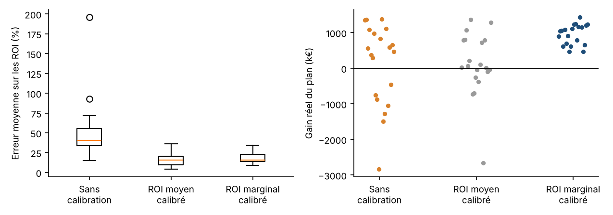

# Robustesse : le résultat tient-il sur d'autres marchés simulés ?

20 marchés simulés (graines 100 à 119) : nouvelles dépenses, promotions, bruit et erreurs de mesure des tests (15 %) à chaque fois. Tests sur : tv, meta, youtube, search, ooh. Réallocation limitée à ±30 % par canal, budget total constant.

- **Test d'arrêt** (lift test classique) : on coupe le canal dans des régions tests ; mesure le ROI **moyen**.
- **Test ±30 %** : on augmente ou baisse la dépense du canal de 30 % dans des régions tests ; mesure le ROI **marginal**, c'est-à-dire ce que rapportent les euros qu'on envisage de déplacer.

| Médiane (P10 ; P90) sur les marchés | Sans calibration | Calibré, ROI moyen (tests d'arrêt) | Calibré, ROI marginal (tests ±30 %) |
|---|---|---|---|
| Erreur de prédiction (MAPE, 26 semaines non vues) | 1.4 % (1.1 ; 1.8) | 2.0 % (1.4 ; 2.4) | 2.0 % (1.6 ; 2.6) |
| Erreur moyenne sur les ROI | 40 % (27 ; 74) | 16 % (9 ; 26) | 16 % (9 ; 30) |
| Marchés où le plan recommandé **fait perdre** des ventes | 7 / 20 | 8 / 20 | 0 / 20 |
| Gain réel du plan, médiane (k€) | 519 | 45 | 1 051 |
| Gain promis par le modèle, médiane (k€) | 3 216 | 3 763 | 1 988 |
| Part du meilleur gain possible obtenue, médiane | 35 % | 3 % | 70 % |
| Meilleur gain possible, médiane (k€, connaissant la vérité) | 1 465 | | |

